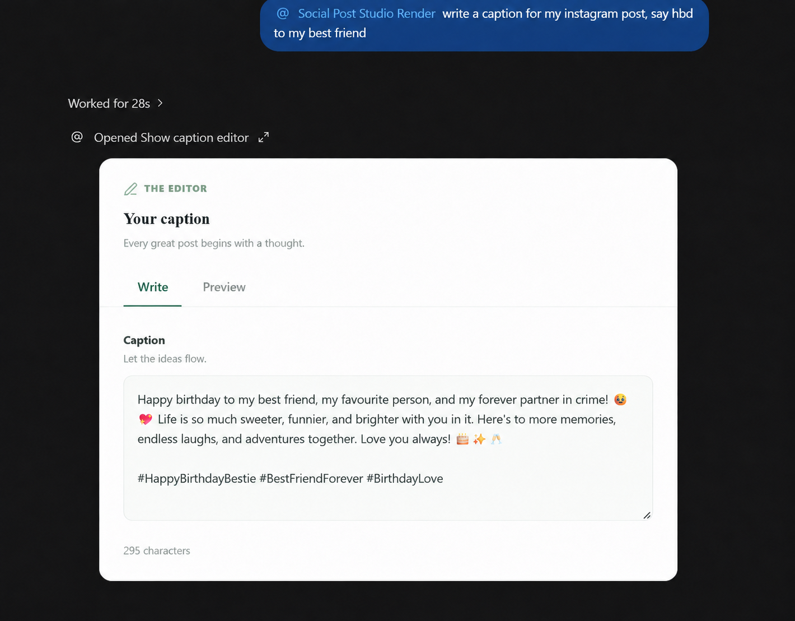
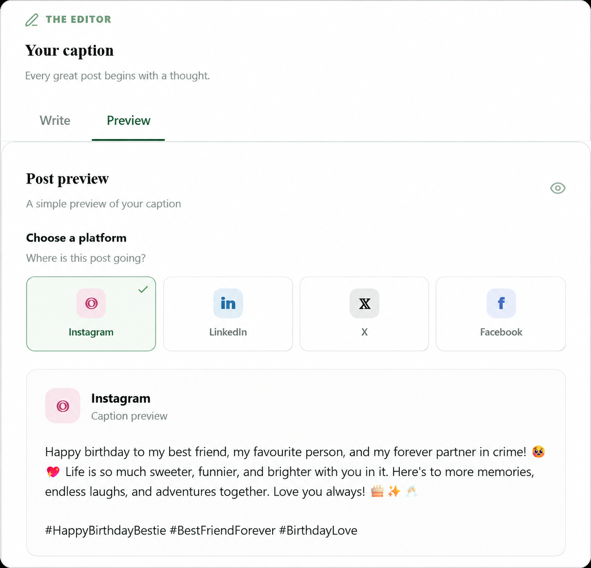
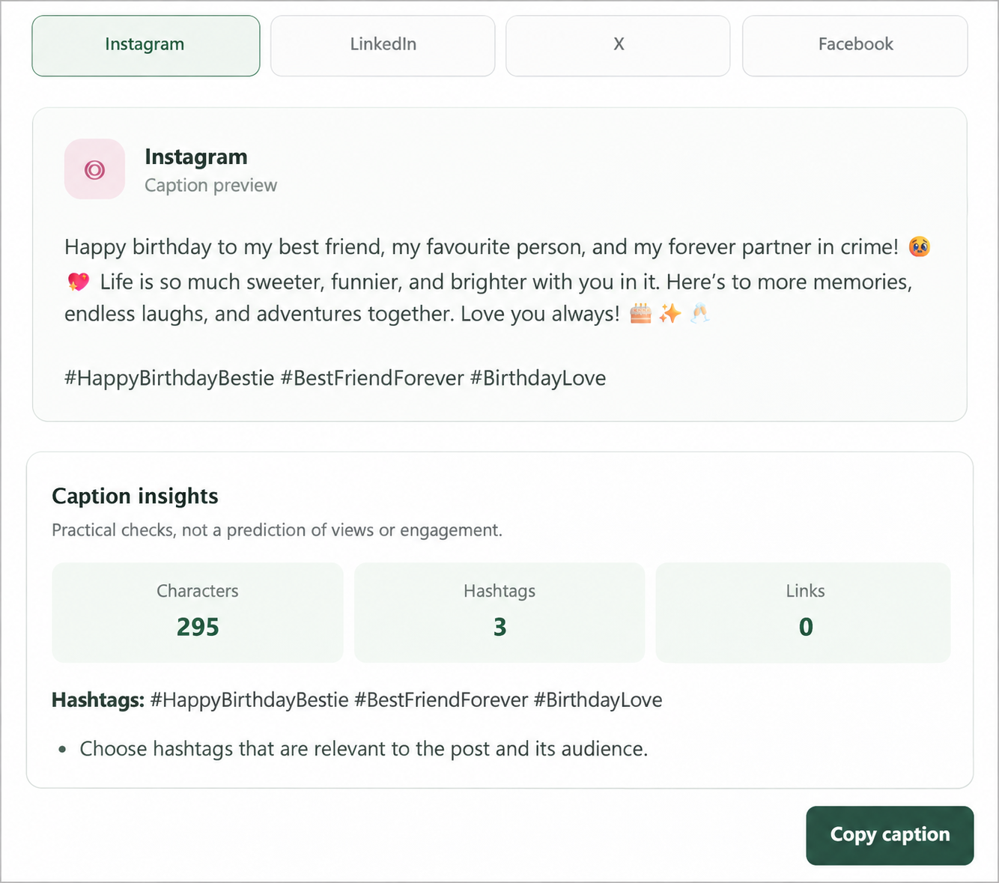

# Social Post Studio

Social Post Studio is a TypeScript full-stack portfolio project for creating and reviewing social media captions. Its primary experience is a ChatGPT app: ChatGPT writes a caption, and an interactive React widget lets the user edit it, preview it, inspect practical text checks, and copy it.

The repository also contains an earlier standalone draft workspace with an Express API and PostgreSQL. It is a separate local experience and is not currently deployed with the ChatGPT MCP service.

## Demo

The images below are visually edited from screenshots of the ChatGPT app to make the interface easier to see.

**Write and edit a caption**



**Preview the post for a selected platform**



**Review caption insights and copy**



## What it does

- Works with Instagram, LinkedIn, X, and Facebook.
- Gives ChatGPT structured tools to prepare a caption brief, display the editor, and analyze a caption.
- Shows character, hashtag, and link counts; detects repeated hashtags and link domains; and offers contextual tips. Visible characters are counted as Unicode grapheme clusters, so an emoji may count as one character.
- Updates analysis after edits or a platform change. These checks do not predict reach or guarantee engagement.
- Supports inline Markdown links returned by the model by converting them to copyable plain text in the ChatGPT editor. A different link label is kept alongside its URL.
- Offers Write and Preview tabs and a copy button. If the ChatGPT host blocks automatic clipboard access, the widget selects the text and shows a manual-copy instruction.
- Includes a separate draft workspace with local PostgreSQL persistence and optional image attachments.

## Architecture

```text
ChatGPT  <--- MCP over HTTPS --->  Node.js MCP server
    |                                  |
    | renders widget                   +-- caption analysis
    v                                  +-- built React widget resource
React widget  ---- MCP app bridge ----> analyze_caption tool
```

ChatGPT generates the caption; this project does not call a separate AI API. The MCP service exposes `prepare_caption`, `show_caption_editor`, and `analyze_caption`. It serves the built widget as an MCP resource. The widget runs inside ChatGPT and calls the analysis tool through the MCP Apps bridge.

The separate standalone application uses Vite, React, an Express draft API, and PostgreSQL. It does not share the ChatGPT widget's save flow. The current Render deployment runs the MCP service, not the standalone draft API.

## Project layout

```text
server/
  mcp/                       MCP HTTP entry point and tool registration
  features/caption-analysis/ Caption analysis, link handling, and tests
  features/drafts/           Standalone draft API and data access
  features/platforms/        Social platform IDs
  database/                  PostgreSQL connection and migration
  index.ts                   Standalone Express API entry point
widget/
  src/chatgpt/               ChatGPT widget and caption insights
  src/features/drafts/       Shared editor and standalone draft features
  src/components/            Standalone UI components
  vite.chatgpt.config.ts     Single-file ChatGPT widget build
  vite.config.ts             Standalone app and local API proxy
compose.yaml                 Local PostgreSQL container
.env.example                 Example local database configuration
```

## Requirements

- Node.js 24.22.1, as specified by `.node-version`, and npm.
- Docker and Docker Compose only for the standalone draft workspace.
- A ChatGPT account with access to custom MCP connections for testing the ChatGPT app.

Install dependencies from the repository root:

```bash
npm ci --prefix server
npm ci --prefix widget
```

## Run the ChatGPT MCP server locally

Build the single-file widget, then start the MCP server:

```bash
npm run build:chatgpt --prefix widget
npm run mcp:production --prefix server
```

The MCP endpoint is `http://127.0.0.1:3001/mcp`. Set `MCP_PORT` if another local port is needed. A remote ChatGPT connection cannot reach localhost directly: use a suitable HTTPS tunnel for development, or deploy the service to a reachable HTTPS endpoint. The MCP server and caption analysis do not require the database or an API key.

The server defaults to localhost. When `PORT` is supplied by a hosting platform, it listens on `0.0.0.0` at that port. Do not set `PORT` for ordinary local use unless network access is intended.

In ChatGPT's plugin settings, add a custom MCP server using the HTTPS URL ending in `/mcp`. After changes to tool metadata or UI resources, rebuild and restart the service, refresh the connection's tools, and open a fresh widget in a new request. A previously rendered widget can retain an older version.

## Run the standalone draft workspace

Copy `.env.example` to `.env` in the repository root and choose a local database password. The file is ignored by Git; never commit real credentials. From the root:

```bash
docker compose up -d
npm run migrate --prefix server
npm start --prefix server
```

In a second terminal:

```bash
npm run dev --prefix widget
```

Open the local URL printed by Vite. The dev server proxies `/drafts` requests to the Express API on `127.0.0.1:3000`. `GET /health` checks the Express server. The PostgreSQL container uses the settings in `.env`; this database is independent of the ChatGPT caption workflow.

## Checks

```bash
npm run typecheck --prefix server
node --test server/features/caption-analysis/analyze-caption.test.ts
npm run build --prefix widget
npm run build:chatgpt --prefix widget
```

## Deploy the MCP service on Render

Use a Node Web Service with the repository root as the root directory. The repository's `.node-version` selects the Node version. Configure:

- **Build command:** `npm ci --prefix server && npm ci --prefix widget && npm run build:chatgpt --prefix widget`
- **Start command:** `npm run mcp:production --prefix server`
- **Auto-deploy:** Off if deployments should be manually selected.

No database credentials or OpenAI API key are needed for this service. Render supplies `PORT`. After deployment, connect ChatGPT to `https://<your-service>.onrender.com/mcp`, not the root URL. The root path may return `Not found` because it is not a website route.

Render's free service can sleep during inactivity, so the first request may be delayed or time out. A stable hostname does not guarantee availability. The current MCP endpoint has no authentication; it provides the read-only caption tools described above and does not expose the standalone draft database. Review authentication, abuse protection, privacy, and hosting requirements before sharing more widely or adding user-specific data.

To release a later version when auto-deploy is off, commit and push the intended changes, then trigger a manual deploy in Render. Updating the GitHub repository and deploying are separate actions.

## Current limitations

- Caption analysis is rule-based; it does not access social-network analytics, validate hashtag popularity, or predict views.
- URL detection handles HTTP(S), `www.` and common inline Markdown links; it is not a complete Markdown or URL parser.
- The ChatGPT widget does not save or publish posts. The standalone draft workspace is a separate earlier workflow.
- A change to the preview platform changes the preview and checks; it does not automatically rewrite the caption for that platform.
